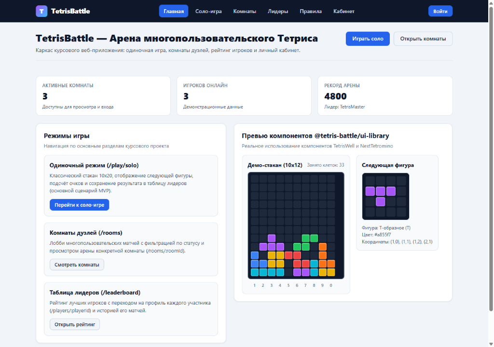
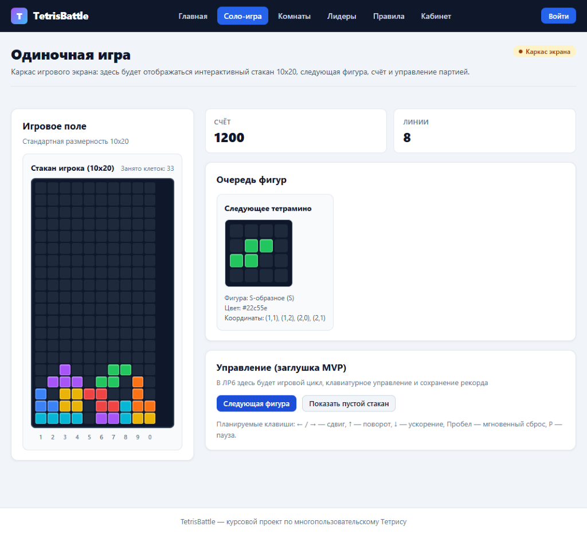
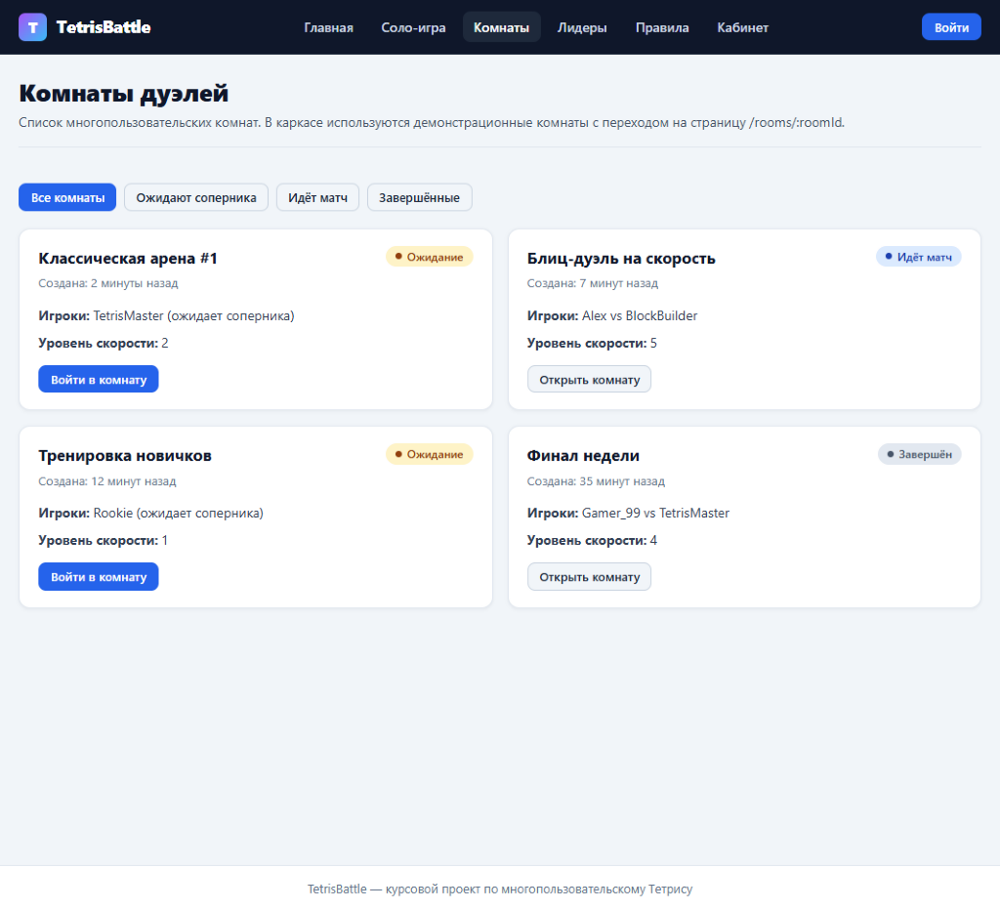
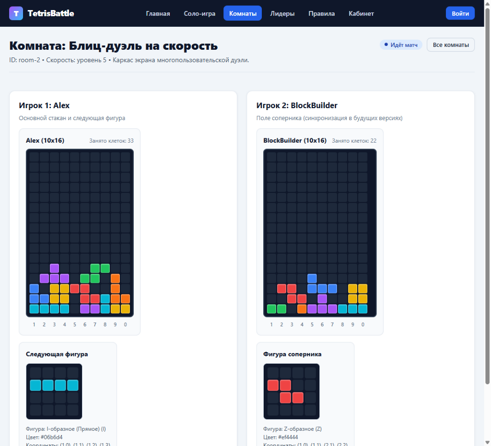
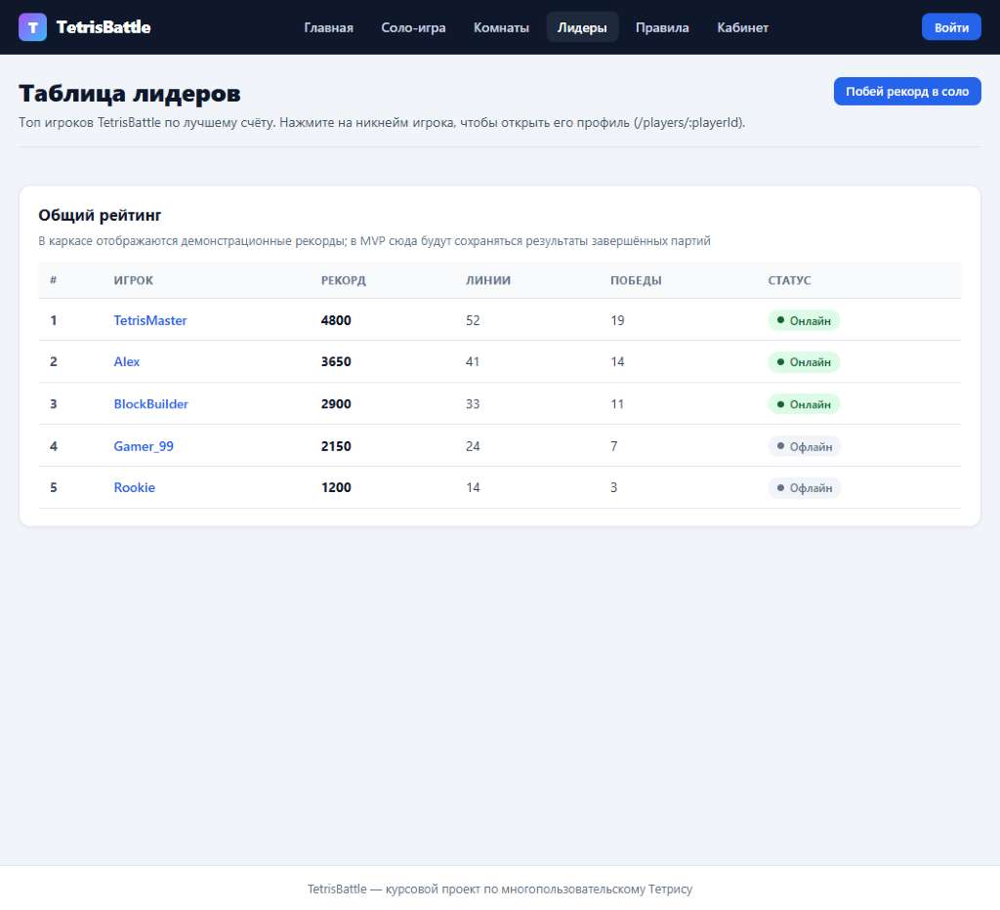
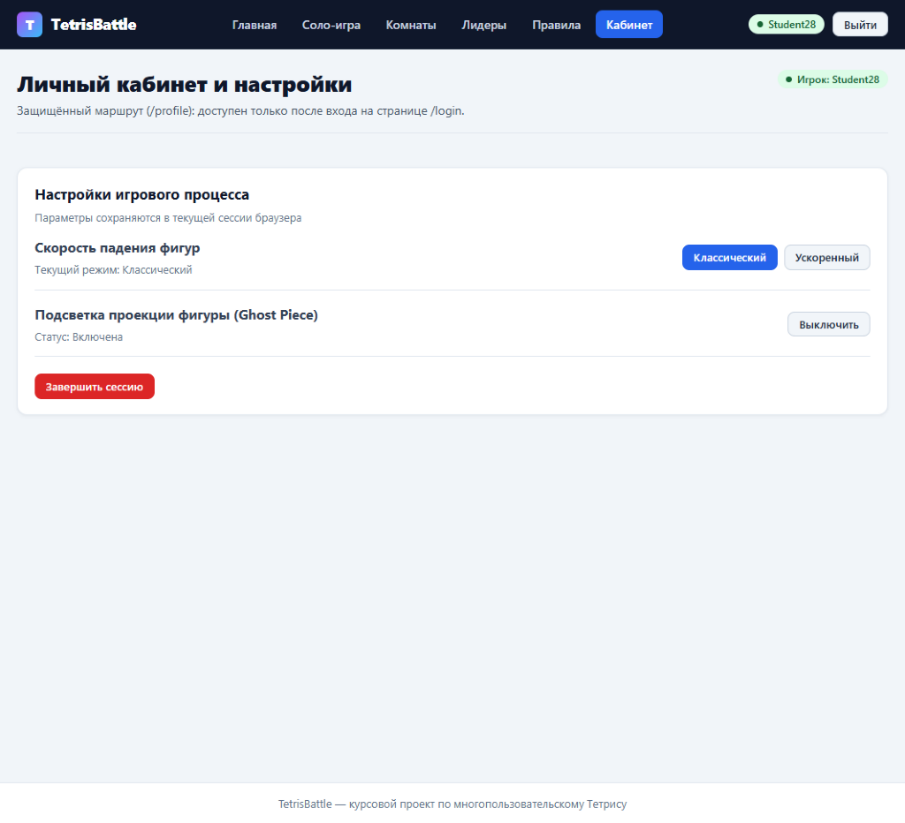

# TetrisBattle — Многопользовательский Тетрис (Курсовая работа, вариант 28)

Учебный курсовой проект на **React + TypeScript + Vite**: каркас веб-приложения многопользовательского Тетриса и библиотека переиспользуемых UI-компонентов.

## Документация проекта

- [`architecture.md`](./architecture.md) — структура проектов, библиотеки и их версии, перечень компонентов, маршрутизация и схема интеграции `ui-library`.
- [`mvp.md`](./mvp.md) — сценарии использования (use cases), границы MVP и критерии приёмки.

## Структура репозитория

Решение состоит из двух самостоятельных проектов:

- **`ui-library`** (`@tetris-battle/ui-library`) — библиотека общих UI-компонентов:
  - `TetrisWell` — стакан Тетриса заданной размерности (`rows` × `cols`) по двумерному массиву чисел;
  - `NextTetromino` — отображение следующего тетрамино по координатам и цвету;
  - `Button`, `Card`, `StatCard`, `StatusBadge`, `PageHeader`, `EmptyState` — базовые компоненты интерфейса.
- **`frontend`** (`tetris-battle-frontend`) — основное веб-приложение с маршрутизацией (`react-router-dom`), подключением `@tetris-battle/ui-library` как локальной зависимости (`file:../ui-library`), параметризованными маршрутами (`/rooms/:roomId`, `/players/:playerId`) и защищённым маршрутом (`/profile` → `/login`).

## Скриншоты работы приложения

### 1. Главная страница (`/`)


### 2. Одиночная игра (`/play/solo`)


### 3. Список комнат дуэлей (`/rooms`)


### 4. Экран комнаты дуэли (`/rooms/:roomId`)


### 5. Таблица лидеров (`/leaderboard`)


### 6. Защищённый личный кабинет (`/profile`)


## Инструкция по запуску

### 1. Установка зависимостей и сборка библиотеки компонентов (`ui-library`)

```sh
cd ui-library
npm install
npm run build
```

### 2. Установка зависимостей и запуск основного приложения (`frontend`)

```sh
cd ../frontend
npm install
npm run dev
```

После запуска приложение доступно по адресу `http://localhost:5173`.

> Скрипты `npm run dev` и `npm run build` в `frontend` автоматически пересобирают `ui-library` через `predev` / `prebuild`.

## Команды проверки качества

В обоих проектах (`ui-library` и `frontend`) доступны команды:

- `npm run dev` — запуск в режиме разработки (`vite build --watch` в `ui-library`, `vite` в `frontend`)
- `npm run build` — проверка типов TypeScript и сборка проекта
- `npm run lint` — проверка стиля кода ESLint (без ошибок и предупреждений)
- `npm run lint:fix` — автоматическое исправление замечаний ESLint
- `npm test` — запуск юнит- и интеграционных тестов (Jest)
- `npm run test:coverage` — запуск тестов с отчётом покрытия кода
